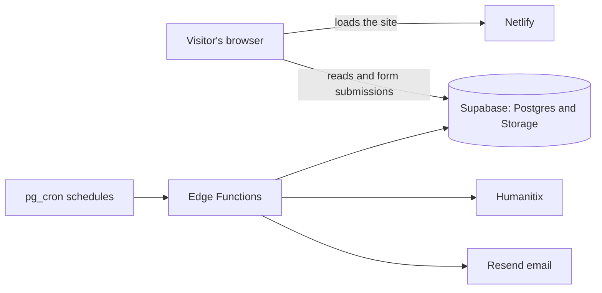

# Kava & Pyramids website


[](https://github.com/karlos-h/K-P-Website/actions/workflows/ci.yml)

**Live site:** [kavapyramids.com](https://kavapyramids.com)

The booking, press and media site for Kava & Pyramids, a DJ duo from Christchurch, New Zealand. Promoters can send a booking enquiry and download a press kit. Fans can find upcoming shows, play mixes and sets, browse event photos and submit their own.

Designed and built by [Karlos Hennings](https://www.linkedin.com/in/karlos-hennings-744a46253), one half of the duo, with AI coding assistance (Claude Code). Karlos set the requirements, made the product decisions and tested the features on the live site.

## What it does

- Upcoming and past shows, with ticket links, driven by the database so a new event needs no code change
- SoundCloud mixes, a YouTube sets carousel, and Instagram and TikTok feeds
- A booking enquiry form that emails the duo when someone submits it
- An electronic press kit with a downloadable PDF
- A media hub of event photo galleries, including credits and links for each photographer
- Crowd POV, where people who attended a show submit their own photos for review
- A private admin dashboard for running events, galleries, venues, enquiries, the mailing list and photo submissions without touching code

## How it's built

| Area | Tools |
| --- | --- |
| Frontend | React 19, Vite 8, React Router 7, Framer Motion, hand-written CSS |
| Backend | Supabase: Postgres with row-level security, Auth, Storage, Edge Functions (Deno), pg_cron |
| Hosting and CI | Netlify, GitHub Actions |
| Integrations | Humanitix (ticketing), Resend (email), YouTube Data API, SoundCloud, Behold (Instagram), SociableKit (TikTok) |



There is no custom server. The browser talks to Supabase directly, so access rules live in the database rather than in application code.

## Engineering notes

- Row-level security policies control every table. Visitors can read public content and submit forms, but only allowlisted accounts can see enquiries or contact details. The rules are version-controlled in [`supabase/migrations`](supabase/migrations).
- A security audit found policies that were broader than intended, some of which existed only in the live database. They were fixed and brought under version-controlled migrations.
- Visitor photos are processed in the browser before upload ([`processImage.js`](frontend/src/lib/processImage.js)). Re-encoding removes EXIF data such as GPS coordinates, converts iPhone HEIC files to JPEG and caps the image size.
- Submitted photos wait in a private storage bucket and only reach the public one after review. A visitor report hides a published photo straight away, and database-level caps limit abuse of the report and upload forms.
- The ticketing sync adds buyers to the mailing list only when they opted in at checkout, and a later sync never resubscribes someone who has unsubscribed ([`humanitix-sync`](supabase/functions/humanitix-sync/index.ts)).
- Scheduled database jobs mark past shows automatically and clear orphaned uploads every hour.
- Each route gets its own static HTML head at build time, so search engines and link previews see the right title without running JavaScript. The build fails if those tags stop matching ([`vite.config.js`](frontend/vite.config.js)). The home page also carries `MusicGroup` structured data.
- Public forms use honeypot fields to catch spam bots, and Netlify sends HSTS, frame-blocking and content-type security headers ([`netlify.toml`](netlify.toml)).

## Project layout

```
frontend/    React app: pages, components, hooks, styles
supabase/    Database migrations and Edge Functions
docs/        Media workflow notes
```

## Running it locally

```bash
cd frontend
npm install
npm run dev
```

The app connects to its hosted backend by default, so you don't need a setup file. Use `npm run lint` and `npm run build` to check changes.

## Testing

GitHub Actions runs ESLint and a production build on every push and pull request. There are no unit tests yet.

## Release history

Every release is tagged and described in [CHANGELOG.md](CHANGELOG.md).

## Licence

This project isn't open source. All rights reserved. Third-party attribution is in [LICENSES.md](LICENSES.md).
